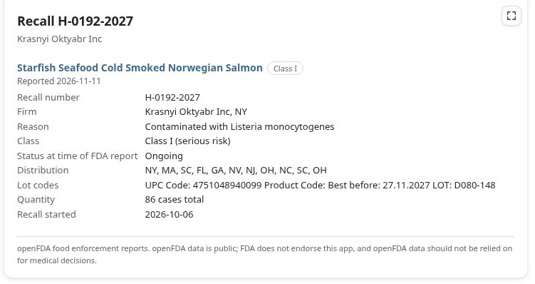

# Food Recall Check

Look beyond a brand name. Food Recall Check opens the FDA enforcement record so you can compare the package size, lot code, reason, and distribution with the item in front of you.

[Connect with Claude, ChatGPT, Muse Code, or Grok](PROVIDERS.md)

## Try it

- Show recent Class I FDA food recalls, then open one for its lot codes and distribution.
- I have a packaged cheese product. Help me check its label against FDA recall records.
- Has this company had any FDA food recalls, and what were the reasons?
- Here is my pantry list. Which items have recall records I should check against the package?

## Install in Claude

In Claude Code, run the following commands.

```text
/plugin marketplace add OpZero-sh/plugins
/plugin install food-recall-check@opzero
```

In Claude chat or Cowork, open the installed plugin’s **Connectors** tab and connect the listed service. The hosted service uses public data and needs no sign in. Then ask a question or name one of the skills below.

## What is included

### Skills

| Skill | What it does |
| --- | --- |
| `check-a-product` | Compares one package with FDA enforcement records field by field: product, size, UPC, lot code and best by date. The answer is a match, a mismatch on a named field, or what is still needed. |
| `recent-recalls` | Lists the newest FDA food recall reports for a window of days, optionally Class I only, grouped by firm and class, and opens any entry for lot codes and distribution. |
| `recall-history` | Searches reports by company, brand, food, allergen or contaminant, groups records into recall events, and explains a single record by its recall number. |

Each skill carries reference files that Claude reads when needed: rules for matching lot codes and dates, where identifiers are printed on a label, a glossary of record fields with FDA's three recall classes, notes on what record counts do and do not mean, and how the search matches phrases.

### Agents

| Agent | When Claude delegates to it |
| --- | --- |
| `lot-match` | One package with several candidate recalls or a long code list. It returns a side by side comparison for each recall number. |
| `pantry-sweep` | A list of many products. It screens each one and reports which have candidate records and what to read from the package. |

Both agents are limited to the three read only lookup tools of the connector.

### Hooks

None. The plugin installs no hooks and runs no scripts on your machine during use.

## What the plugin connects to

- **One hosted MCP server**, `fda`, at `https://food-recall-check.mcp.opzero.sh/mcp`. It needs no sign in. Each tool call sends the search words, the recall number or the window in your request to that server, which looks them up in FDA's public food enforcement data and returns the records. The server states that requests are not stored. Its tools are `search_food_recalls`, `recent_food_recalls` and `get_food_recall`, all read only.
- **Links in answers.** Answers cite the openFDA record for each recall and the FDA and USDA recall pages for you to open. The plugin does not fetch those pages.

## Optional files for other clients

These files are not used by Claude. Nothing in them runs unless you run it yourself.

- `integrations/grok_example.py` is a sample script for the xAI API. When you run it without the dry run flag, it reads `XAI_API_KEY` from your environment, and `XAI_MODEL` if set, and sends your question with the server address and tool list to `https://api.x.ai/v1/responses`. With `--dry-run` it prints the request and sends nothing.
- `integrations/grok-servers.json` holds the server address and tool list that script uses.
- `integrations/openai/` holds the manifest and connection file for the ChatGPT and Codex package.
- `scripts/build_openai.py` builds that package as a ZIP on your machine from the manifests, the skills, the license and the product icon. It makes no network requests.
- `.muse-plugin/plugin.json` is the manifest for Muse Code.

## Sources and coverage

The source is FDA's food enforcement reports. It covers foods FDA regulates, including dietary supplements and pet food. Enforcement reports are posted weekly and can trail a company's public announcement by weeks. Meat, poultry and certain egg products are regulated by USDA and have a separate recall source.

A search that finds nothing does not show that a product is safe. A record that matches your package means you should not eat it. Instructions for disposal or a refund come from the recalling company or the store, not from this data. If someone may be ill from a food, contact a health care provider, or emergency services for severe symptoms. This plugin provides public information and is not medical advice.

[FDA public recall notices](https://www.fda.gov/safety/recalls-market-withdrawals-safety-alerts) · [USDA FSIS recalls](https://www.fsis.usda.gov/recalls)

- [food-recall-check](https://food-recall-check.mcp.opzero.sh/) · [Privacy](https://food-recall-check.mcp.opzero.sh/?page=privacy) · [Support](https://food-recall-check.mcp.opzero.sh/?page=support)

## In use

Examples from the connected services in Claude.


